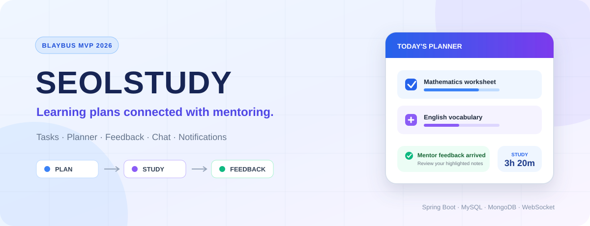
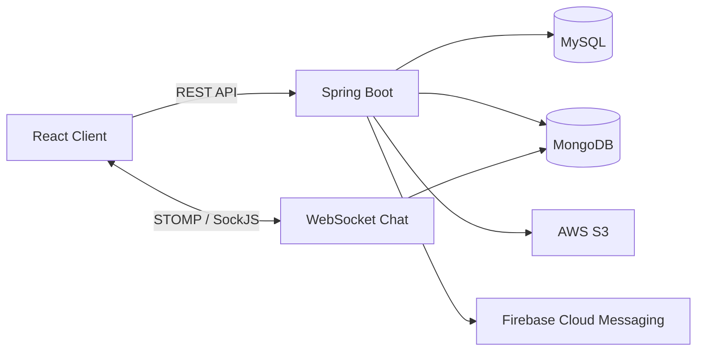

<div align="center">



# 설스터디 Backend

**수능 국어·영어·수학 학습 계획과 멘토 피드백을 연결하는 학습 코칭 플랫폼의 백엔드**

[](#프로젝트-상태)
[](#기술-스택)
[](#실행-방법)
[](LICENSE)

</div>

---

## 프로젝트 소개

설스터디는 멘티의 일일 학습 계획과 과제 수행 현황을 멘토가 확인하고, 목표·피드백·채팅으로 학습을 관리할 수 있도록 만든 팀 프로젝트입니다. 실제 창업팀의 아이디어를 바탕으로 제4회 Blaybus MVP 개발 해커톤에서 약 10일 동안 핵심 흐름을 구현했습니다.

- Frontend: [Team-Wego/SeolStudy-FE](https://github.com/Team-Wego/SeolStudy-FE)
- Backend: 현재 저장소



## 프로젝트 상태

> **Status: Hackathon MVP / Backend Source**
>
> 해커톤 기간에 서비스의 핵심 API와 실시간 채팅·알림 흐름을 구현한 MVP입니다. 운영 중인 상용 백엔드가 아니며, 로컬 실행에 필요한 DB 초기화 자료와 외부 인프라 설정이 저장소만으로 완전히 제공되지는 않습니다.

### 구현됨

- 멘토·멘티 로그인과 회원 정보·프로필·학생 관리 메모
- 멘토·멘티 과제 CRUD, 순서·상태·제출·이미지 관리
- 플래너 코멘트와 공부 시간 기록·과목별 학습 현황
- 학습 목표, 학습지 파일, 과제·플래너 피드백과 이미지 하이라이트
- 멘토 대시보드 요약과 피드백 대기 과제 조회
- STOMP/SockJS 기반 채팅방·메시지·읽음 상태
- AWS S3 파일 업로드·삭제·Presigned URL
- Firebase 토큰·푸시 알림과 과제 리마인더
- 공통 오류 응답과 Swagger/OpenAPI 설정

### 현재 한계

- 로그인은 저장된 비밀번호를 직접 비교하는 단순 MVP 방식이며 Spring Security·JWT가 적용되지 않음
- 여러 API가 경로·쿠키의 회원 ID를 사용하므로 운영 환경 수준의 인증·인가 검증이 필요함
- WebSocket 허용 Origin과 CORS 설정이 개발 환경 중심으로 구성됨
- Flyway/Liquibase 같은 DB 마이그레이션과 초기 데이터 스크립트가 없음
- MySQL, MongoDB, AWS S3, Firebase를 모두 준비해야 전체 기능 실행 가능
- 자동화 테스트는 Spring Context 로드 1건만 존재하며 외부 인프라가 없는 독립 테스트 환경은 없음

## 도메인별 기능

| 도메인 | 주요 기능 | 저장 방식 |
|---|---|---|
| Member | 로그인, 회원 조회·수정, 프로필 이미지, 멘티 메모 | MySQL / JPA |
| Task | 과제·플래너·공부 시간·제출·학습 현황 | MySQL / JPA + MyBatis |
| Mentoring | 목표, 학습지, 피드백, 멘토 대시보드 | MySQL / JPA + MyBatis |
| Chat | 채팅방, 메시지, 읽음 상태, 미디어 조회 | MongoDB / WebSocket |
| Notification | 알림 목록·읽음·삭제, FCM 토큰, 리마인더 | MySQL / Firebase |
| File | S3 업로드·삭제, 다운로드용 Presigned URL | AWS S3 |

## API 확인

애플리케이션이 실행되면 Swagger UI에서 전체 요청·응답 형식을 확인할 수 있습니다.

```text
http://localhost:8080/swagger-ui/index.html
```

주요 경로는 다음과 같습니다.

| 경로 | 역할 |
|---|---|
| `/members` | 로그인, 회원 정보, 멘티 메모 |
| `/mentees/{menteeId}/tasks` | 멘티 과제 관리 |
| `/mentors` | 멘토 과제와 대시보드 |
| `/goals`, `/feedback` | 목표와 피드백 |
| `/chat/rooms`, `/chat/messages` | 채팅방과 메시지 조회 |
| `/ws/chat` | STOMP/SockJS 연결 엔드포인트 |
| `/notification` | 알림과 FCM 토큰 |
| `/files` | S3 파일 처리 |

## 실행 방법

### 요구 환경

- Java 17
- MySQL
- MongoDB
- AWS S3 Bucket과 접근 자격 증명
- Firebase 프로젝트와 Admin SDK 서비스 계정 파일

### 환경 변수

프로덕션 프로필은 다음 값을 환경 변수로 받습니다.

```text
SPRING_PROFILES_ACTIVE=prod
DB_URL=jdbc:mysql://localhost:3306/seolstudy
DB_USERNAME=...
DB_PASSWORD=...
MONGODB_URI=mongodb://localhost:27017/seol_study_chat
AWS_ACCESS_KEY=...
AWS_SECRET_KEY=...
FIREBASE_API_KEY=...
FIREBASE_APP_ID=...
FIREBASE_VAPID_KEY=...
FIREBASE_CONFIG_PATH=/absolute/path/to/firebase-adminsdk.json
```

`FIREBASE_CONFIG_PATH`는 Spring 외부 설정으로 기존 `firebase.config-path` 값을 덮어쓰기 위한 항목입니다. Firebase Admin SDK JSON과 모든 자격 증명은 Git에 커밋하지 않습니다.

```bash
git clone https://github.com/Team-Wego/SeolStudy-BE.git
cd SeolStudy-BE
./gradlew bootRun
```

Windows에서는 `gradlew.bat bootRun`을 사용합니다.

> 현재 저장소에는 DB 스키마 생성·시드 데이터가 별도 스크립트로 제공되지 않습니다. 실제 실행 전 엔티티 구조와 기존 운영 DB 구성을 함께 확인해야 합니다.

## 기술 스택


## 프로젝트 구조

```text
src/main/java/com/wego/seolstudybe/
├── member/          # 로그인, 회원, 멘티 관리 메모
├── task/            # 과제, 플래너, 공부 시간
├── mentoring/       # 목표, 학습지, 피드백, 대시보드
├── chat/            # MongoDB 채팅과 WebSocket
├── notification/    # 알림, FCM, 리마인더
└── common/          # S3, 설정, 공통 오류 처리
```

## 개인 기여 — 민태훈

프로필에 기록된 역할과 Git 커밋으로 확인되는 구현 범위를 구분해 작성했습니다.

- 프로젝트 역할: PM
- 일정과 기능 우선순위 조율, MVP 범위 정의, 최종 발표 진행
- 로그인 API 구현
- 회원 개인 정보 조회·수정 API 구현
- 멘토의 학생 관리용 메모 조회·수정 API 구현

과제, 피드백, 채팅, 알림 등 다른 백엔드 기능은 팀원이 나누어 구현했습니다.

## Backend Contributors

- [rosieisor](https://github.com/rosieisor)
- [HoodRyan](https://github.com/HoodRyan)
- [ghi512](https://github.com/ghi512)
- [pilltong22](https://github.com/pilltong22)
- [taehuni](https://github.com/taehuni)

기여자 목록은 저장소의 공개 커밋 기록을 기준으로 작성했습니다.

## License

MIT License — 자세한 내용은 [LICENSE](LICENSE)를 참고하세요.
